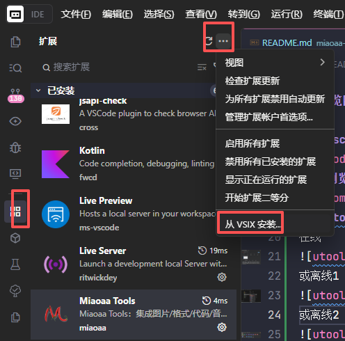
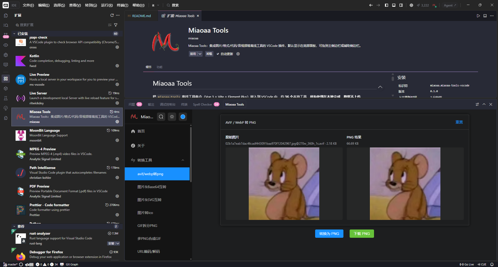
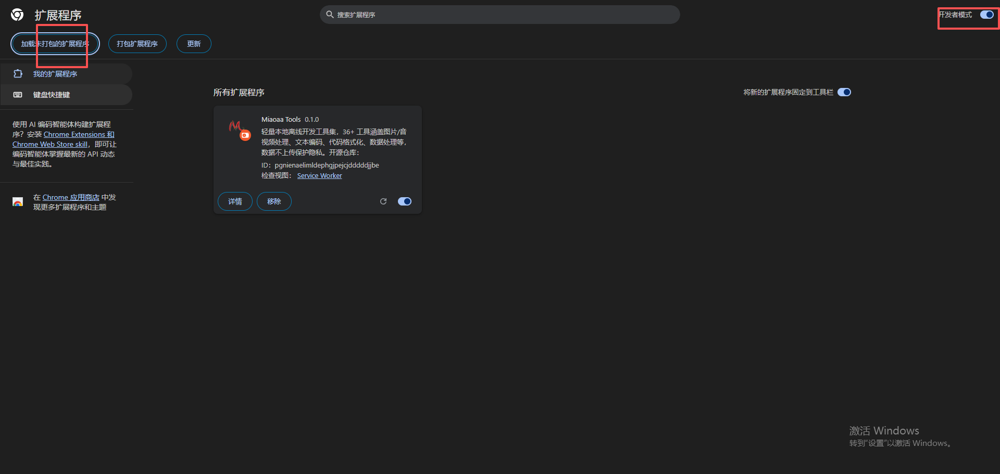
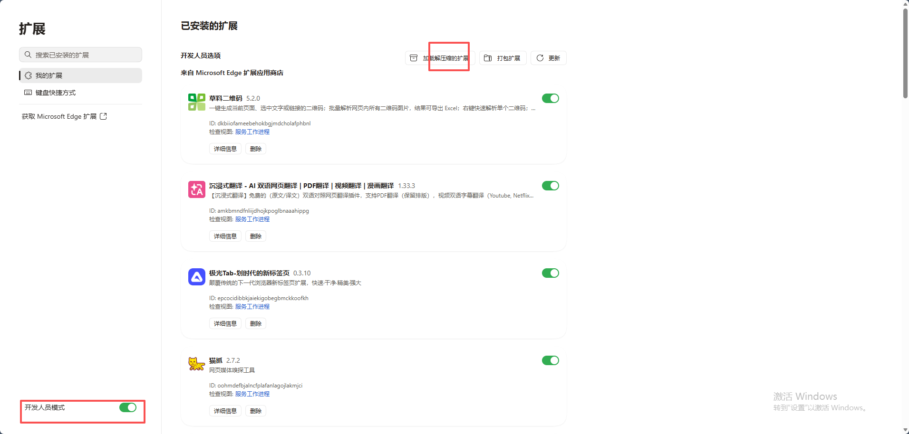
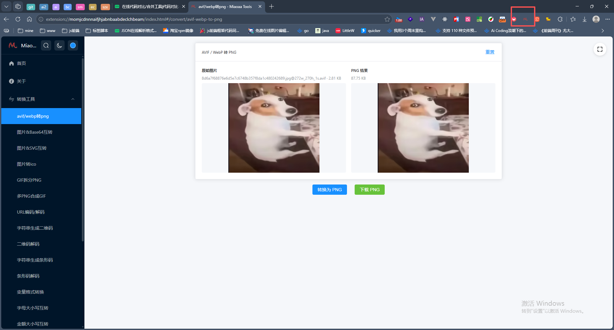
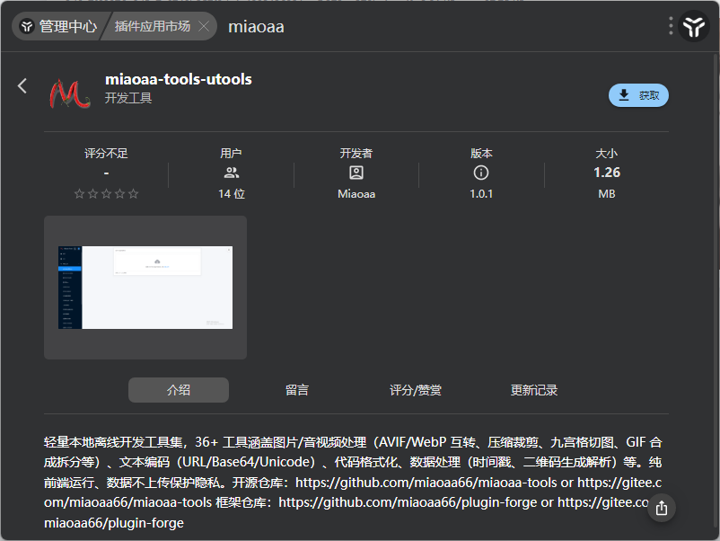
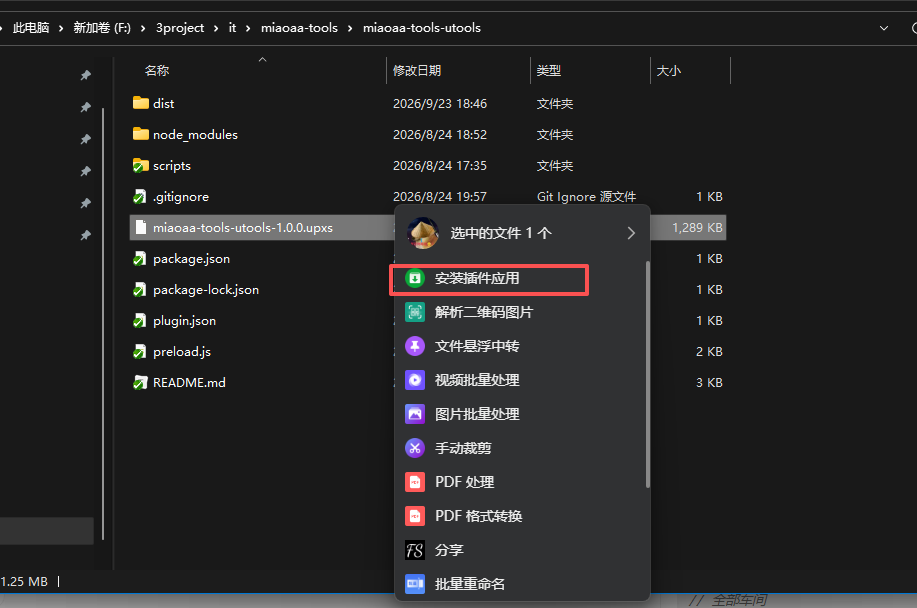
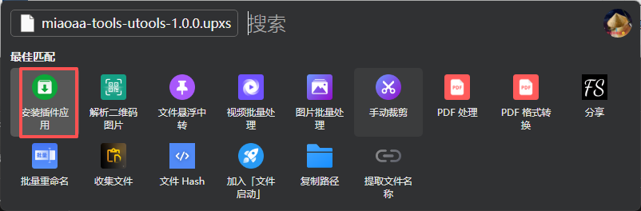
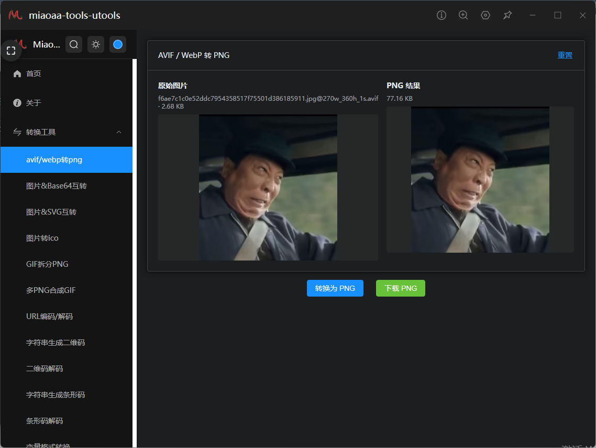

# miaoaa-tools

本地离线开发工具集合（约 36 个工具），提供四种形态：

- **Web 应用**（`miaoaa-tools/`）：Vue 3 + Vite + Element Plus 纯前端工具集，浏览器直接使用
- **浏览器插件**（`miaoaa-tools-browser/`）：Chrome / Edge 扩展，点击工具栏图标在新标签页打开工具集
- **VSCode 插件**（`miaoaa-tools-vscode/`）：把同一个工具集嵌入 VSCode，可在底部面板 / 主侧边栏 / 辅助侧边栏使用
- **uTools 插件**（`miaoaa-tools-utools/`）：在 uTools 搜索框输入关键词唤起，窗口内打开工具集

所有工具均在本地运行，数据不上传，保护隐私。


## 预览图

### vscode安装插件 
离线  

### vscode使用插件   

### 浏览器安装插件 
chrome离线  

edge离线

### 浏览器使用插件   

### utools安装插件 
在线,插件市场搜索  

或离线1

或离线2

### utools使用插件   



## 目录结构

```
miaoaa-tools/
├── miaoaa-tools/         # Web 应用（Vue 3 + Vite + Element Plus）
├── miaoaa-tools-browser/ # 浏览器插件（Chrome / Edge，MV3）
├── miaoaa-tools-vscode/  # VSCode 插件（扩展外壳 + Webview 内嵌）
├── miaoaa-tools-utools/  # uTools 插件（plugin.json + Web 嵌入）
├── miaoaa-tools-doc/     # 文档站点（VitePress，介绍全部工具与形态）
├── LICENSE
└── README.md
```

## 快速开始

### 环境要求

- Node.js >= 26.7.0（推荐这个版本，我本地是这个版本）

### Web 应用

```bash
cd miaoaa-tools
npm install
npm run dev       # 开发
npm run build     # 构建生产版本
```

### 浏览器插件

```bash
cd miaoaa-tools-browser
npm install
npm run package   # 构建 webview 并打包成 .zip
```

产物为 `miaoaa-tools-browser/dist/`（可加载目录）与 `miaoaa-tools-browser/miaoaa-tools-browser-<version>.zip`（分发包）。安装方式：`chrome://extensions` 打开「开发者模式」→「加载已解压的扩展程序」→ 选择 `dist/`。

### VSCode 插件

```bash
cd miaoaa-tools-vscode
npm install
npm run package   # 构建 webview 并打包成 .vsix
```

打包产物为 `miaoaa-tools-vscode/miaoaa-tools-vscode-<version>.vsix`，在 VSCode 扩展面板「从 VSIX 安装」即可。

### uTools 插件

```bash
cd miaoaa-tools-utools
npm install
npm run package   # 构建 web 并组装 dist/（不再产 .upx）
```

产物为 `miaoaa-tools-utools/dist/`（核心交付物）。**uTools v5.0.0 起将安装包格式升级为 `.upxs`（加密 + 开发者信息签名）**，任何普通 zip 工具改名的 `.upx` 在 v5.0.0 及之后版本均**不会被识别为插件安装包**。`.upxs` 需用「uTools 开发者工具」导入 `dist/plugin.json`，点「打包 UPXS」生成。安装方式任选其一：① 在文件资源管理器中左键单击选中 `.upxs`，按**鼠标中键**（默认触发键，未修改设置时）呼出超级面板 → 「安装插件应用」（超级面板已关闭则用方式②）；② 复制 `.upxs`，按 `Alt + Space`（默认快捷键，未修改设置时）呼出搜索框，粘贴 → 「安装插件应用」。

## 文档

基于 VitePress 的完整使用文档，详细介绍 4 种形态、全部工具（含运行截图）以及作者的其他开源项目：

```bash
cd miaoaa-tools-doc
npm install
npm run docs:dev       # 本地预览
npm run docs:build     # 构建静态站点（产物 docs/.vitepress/dist/）
```

## 技术栈

- **Web 应用**：Vue 3.5 / Vite 8 / Pinia / Element Plus / Vue Router
- **浏览器插件**：Chromium MV3（manifest v3 + service worker）
- **VSCode 插件**：TypeScript + esbuild（扩展端）/ @vscode/vsce（打包）
- **uTools 插件**：plugin.json（uTools 清单）+ uTools 开发者工具（v5.0.0+ 打包为加密签名的 `.upxs`；官方未提供命令行打包工具）

## 此项目开发模板：

[plugin-forge github](https://github.com/miaoaa66/plugin-forge)   
[plugin-forge gitee](https://gitee.com/miaoaa66/plugin-forge)   

## ⚠️ 仓库说明
本项目**主仓库位于 Gitee**，GitHub 为自动单向同步的只读镜像。

1. 你可以自由 Fork GitHub 上的代码副本，但所有代码提交、Bug反馈、功能建议、Pull Request，请前往 Gitee 主仓库。
2. GitHub仓库所有文件由Gitee自动同步覆盖，任何在此处的手动修改都会丢失。

👉 Gitee主仓库地址：https://gitee.com/miaoaa66/miaoaa-tools

## 许可证

[MIT](LICENSE)
